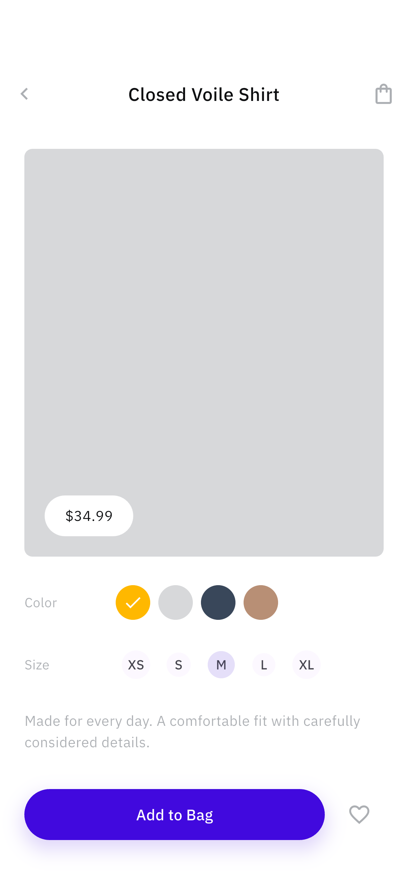
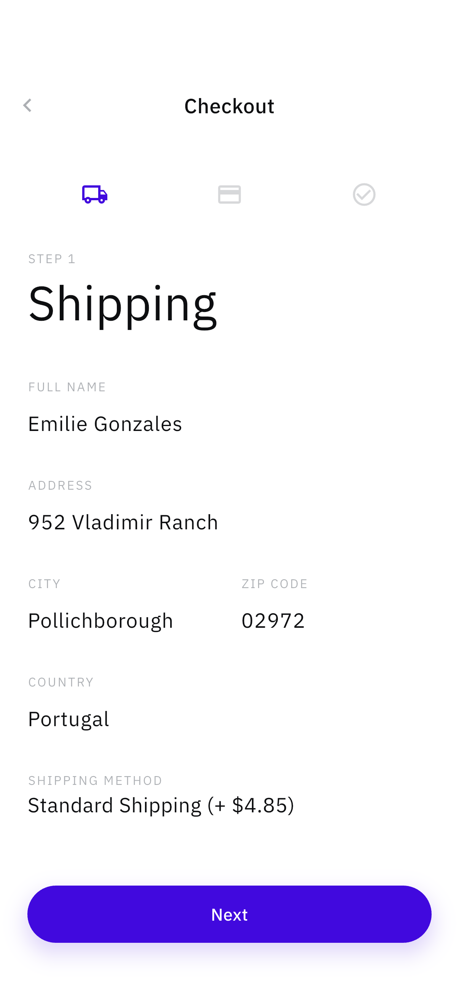
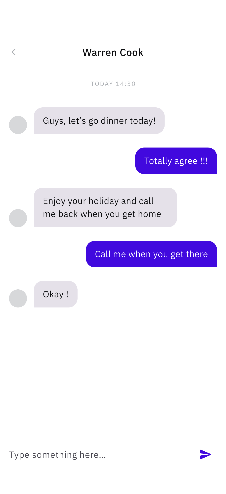
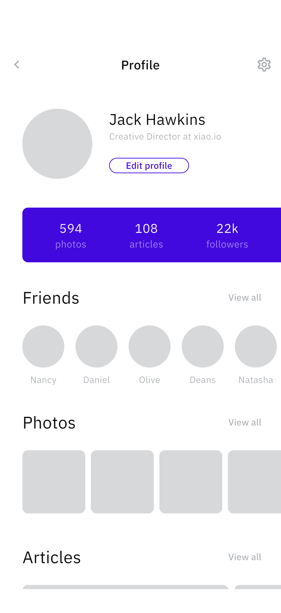
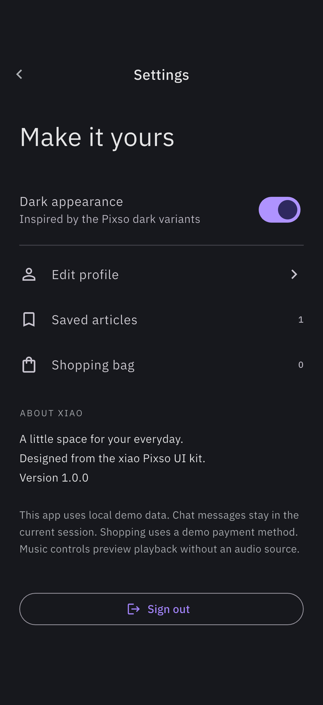
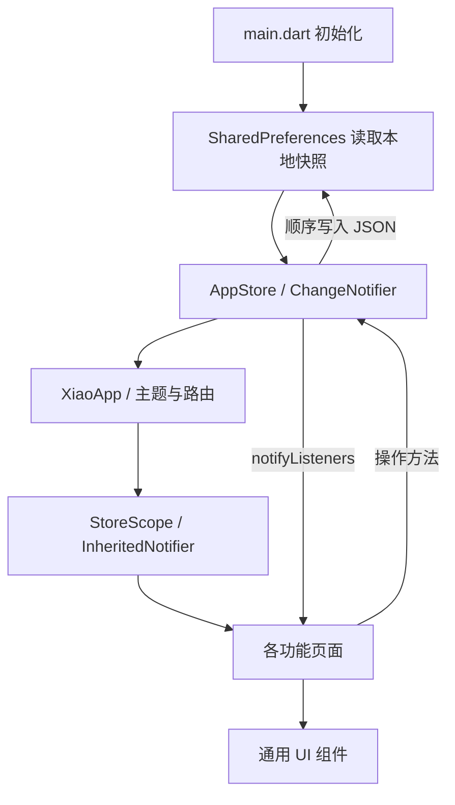
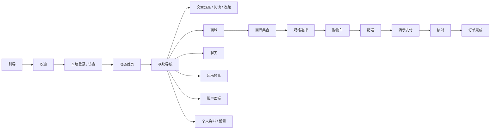

# xiao Flutter 项目说明与架构

## 1. 项目目标

xiao 是基于 Pixso xiao UI Kit 的综合演示 App。采用用户选定的“各模块主要界面”范围，将原本独立的设计示例组织成可以连续操作的应用。

设计文件含 10 类界面以及 Style Guide，共 264 个浅色和深色变体。本项目实现 24 个路由，结算包含 3 个步骤，另附深色示例。没有将全部设计变体逐一实现。

界面保留设计稿的紫色、IBM Plex Sans、圆角按钮、灰色图片占位与主要排版。为便于实际使用，新增了搜索、导航入口、表单校验、空状态及演示说明。设计稿中显示为缺字方框的图标使用 Flutter Material Icons 对应替换。

## 2. 主要界面

下图由 iOS 模拟器实际运行截图组成。更多原始截图见 [完整截图目录](SCREENSHOTS.md)。


| 引导与登录 | 商品详情 | 配送信息 |
| --- | --- | --- |
|  |  |  |

| 聊天详情 | 个人资料 | 深色设置 |
| --- | --- | --- |
|  |  |  |

## 3. 已实现功能

| 模块 | 页面与交互 |
| --- | --- |
| 引导 / 账号 | 4 页滑动引导、欢迎、登录、注册、密码显隐、邮箱和密码校验、访客入口、本地会话恢复 |
| 导航 | 紫色渐变菜单，连接全部模块，退出后返回欢迎页 |
| 动态 | 作者搜索、关注、点赞、收藏、点击内容进入文章 |
| 文章 | 分类关注、按分类浏览、标题搜索、推荐 / 精选切换、文章阅读、作者关注、收藏列表与空状态 |
| 商城 | 活动首页、商品网格、类别与价格筛选、搜索、颜色 / 尺码选择、产品收藏 |
| 购物车 | 合并相同商品变体、数量调整、滑动删除、运费与总额计算、空购物车提示 |
| 结算 | 配送表单校验、演示支付方式、订单核对、完成反馈、订单编号、提交后清空购物车 |
| 聊天 | 会话搜索、未读 / 已读筛选、联系人选择、消息输入与发送、自动滚动至新消息 |
| 音乐 | 推荐与歌单入口、播放状态预览、进度拖动、上下首、循环、歌单切换、歌曲收藏 |
| 数据面板 | 自绘平滑曲线、日 / 周 / 月 / 年切换、交易列表筛选 |
| 个人资料 | 好友、照片面板、文章入口、资料编辑与校验、保存反馈 |
| 设置 | 深色主题切换、收藏与购物车入口、版本和演示范围说明、退出 |

购物车数量上限为每个变体 99 件。小计达到 $100 免运费，否则运费 $4.85。订单提交具有空购物车检查，防止重复提交。金额仅用于演示。

## 4. 项目结构

```text
xiao/
├── lib/
│   ├── main.dart                    # 初始化本地状态、启动应用
│   ├── app.dart                     # 主题、路由、状态作用域
│   ├── data/
│   │   ├── models.dart              # 商品、购物车、文章、消息、演示数据
│   │   └── app_store.dart           # ChangeNotifier 状态与本地存储
│   ├── ui/
│   │   └── components.dart          # 页面骨架、按钮、占位图、搜索框、表单等
│   └── features/
│       ├── auth.dart                # 引导、欢迎、登录、注册
│       ├── content.dart             # 动态、分类、文章、收藏
│       ├── shop.dart                # 商城、商品、购物车、结算、成功页
│       ├── social_media.dart        # 会话、消息、音乐与播放器
│       └── profile_dashboard.dart   # 导航、资料、设置、账户图表
├── assets/
│   ├── app_icon.png                 # 项目生成的 xiao 图标
│   └── fonts/                       # IBM Plex Sans 与 OFL 许可
├── test/
│   ├── app_store_test.dart          # 购物车、订单、持久化、异常数据、消息
│   └── widget_test.dart             # 登录、占位图尺寸、全路由多尺寸检查
├── integration_test/app_test.dart   # iOS 完整流程与截图采集
├── test_driver/integration_test.dart # 将模拟器截图写入本机目录
├── docs/
│   ├── PROJECT.md                   # 本文档
│   ├── SCREENSHOTS.md               # 全部截图索引
│   ├── TESTING.md                   # 验证记录
│   ├── screenshots/                # 29 张原始截图与概览图
│   └── design_reference/           # Pixso 原始参考图与节点数据
├── ios/                            # iOS 工程
├── android/                        # Android 工程
├── web/                            # Web 工程
└── pubspec.yaml / pubspec.lock
```

## 5. 架构与数据流

采用 Flutter 原生的 ChangeNotifier + InheritedNotifier。此演示规模下不引入额外路由框架、状态管理框架或网络层，减少依赖与重复代码。



页面独有状态放在 StatefulWidget 中，例如搜索词、商品规格、结算步骤、播放器进度。跨页面状态放入 AppStore，例如登录标记、主题、收藏、关注、点赞、购物车和资料。

页面通过 `StoreScope.of(context)` 获取状态。页面调用 `addToCart`、`toggle`、`updateProfile` 等方法，状态更新后通知相关页面，并将可持久化状态顺序写入 `xiao.state.v1` JSON 快照，避免连续操作产生写入顺序颠倒。

| 数据 | 保存范围 |
| --- | --- |
| 会话标记、邮箱、主题、资料 | 本地保存 |
| 收藏、关注、点赞、购物车、订单计数 | 本地保存 |
| 消息内容、播放器进度、表单、搜索条件 | 当前运行会话 / 当前页面 |
| 密码、真实支付信息 | 不保存 |

本地存储采用轻量偏好存储，并非加密账号系统。接入正式账号时，应将认证令牌移入安全存储，服务端负责鉴权。损坏的 JSON 快照不会阻止应用启动。

## 6. 路由与主要流程

| 路由 | 页面 |
| --- | --- |
| `/walkthrough`, `/welcome` | 引导、欢迎 |
| `/login`, `/signup` | 登录、注册 |
| `/menu`, `/feed` | 模块菜单、动态首页 |
| `/categories`, `/articles`, `/article`, `/saved` | 文章分类、列表、正文、收藏 |
| `/shop`, `/catalogue`, `/product` | 商城首页、集合、商品详情 |
| `/cart`, `/checkout`, `/success` | 购物车、三步结算、订单完成 |
| `/chats`, `/conversation` | 会话列表、会话详情 |
| `/music`, `/player` | 音乐推荐、播放器 |
| `/profile`, `/edit-profile`, `/settings` | 资料、资料编辑、设置 |
| `/balance` | 账户面板 |



## 7. Pixso 设计映射

保留的原始参考图位于 `design_reference/`。设计数据以节点为准，不使用整页图片作为 App 界面。

| Pixso 页面 | 代表节点 | 对应实现 |
| --- | --- | --- |
| 01 Walkthrough | `0:2` | 滑动引导 |
| 02 Signup & Login | `0:600`, `0:695` | 欢迎、账号表单 |
| 03 Profile | `0:2797`, `0:3432` | 资料、编辑资料 |
| 04 Feeds | `0:4285` | 动态首页 |
| 05 Articles | `0:5882`, `0:5941` | 分类、文章卡片列表 |
| 06 Navigation | `0:7016` | 紫色渐变模块导航 |
| 07 Ecommerce | `0:7802`, `0:7830`, `0:8125`, `0:8593`, `0:8650`, `0:8836` | 商城、详情、购物车、配送、完成 |
| 08 Social | `0:10039`, `0:10471` | 会话列表与消息气泡 |
| 09 Media | `0:11478`, `0:11622` | 推荐、唱片式播放器 |
| 10 Dashboard | `0:12587` | 曲线和交易列表 |

文章正文、筛选网格、演示支付卡、设置等为按该设计语言补全的功能页面。深色模式采用统一主题适配，不等同于逐一还原全部深色稿。

设计令牌：主色 `#4109DE`，正文 `#0D0E10`，图片占位 `#D7D8DA`，辅助色 `#ACAFB3`。按钮高度 50、胶囊圆角 25；主要内容留白为 16 / 20 / 24 / 32。页面使用 SafeArea，宽屏内容最大宽度 600，长内容滚动显示。

## 8. 运行、验证与交付

```bash
flutter pub get
flutter run
flutter analyze
flutter test
```

模拟器完整测试与截图命令见 [测试记录](TESTING.md)。Android 和 Web 工程已保留；本次运行测试平台为 iOS 模拟器，未执行 Android 真机测试。iOS 真机部署需自行配置开发者签名。

代码精简包括移除不可交互的 Pixso 自动生成页面、计数器样例、无用依赖与导入，合并共享页面骨架、占位图、表单、按钮、商品卡片和订单金额展示。没有额外生成中间工具代码或重复的浅色 / 深色页面类。

## 9. 后续接入位置

当前登录仅验证表单并记录本地状态，不创建服务器账号；购物下单仅生成本地演示编号；消息只写入当前内存会话；播放器没有音频源；图表和交易是示例数据。

需要正式服务时，可在 AppStore 的操作边界引入账号、商品订单、文章和消息 Repository，再将本地实现替换为 API 实现。播放器可接入音频播放服务，灰色占位图可在 GreyBox 的使用位置替换为实际素材。现有路由和视图结构可继续沿用。

字体来自 [IBM Plex 官方仓库](https://github.com/IBM/plex)，SIL Open Font License 随项目附带。设计稿来源为用户提供的 Pixso 文件。
