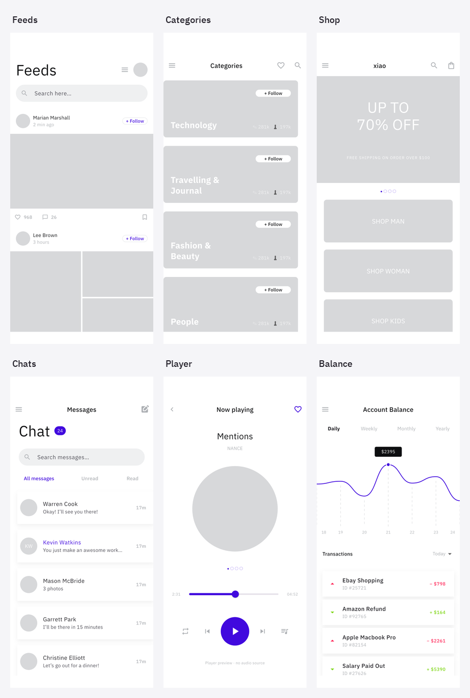
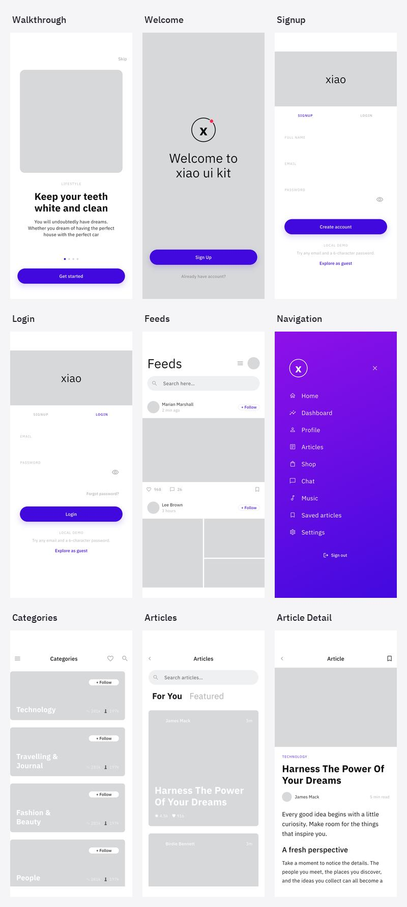
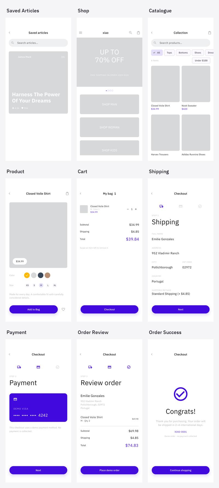
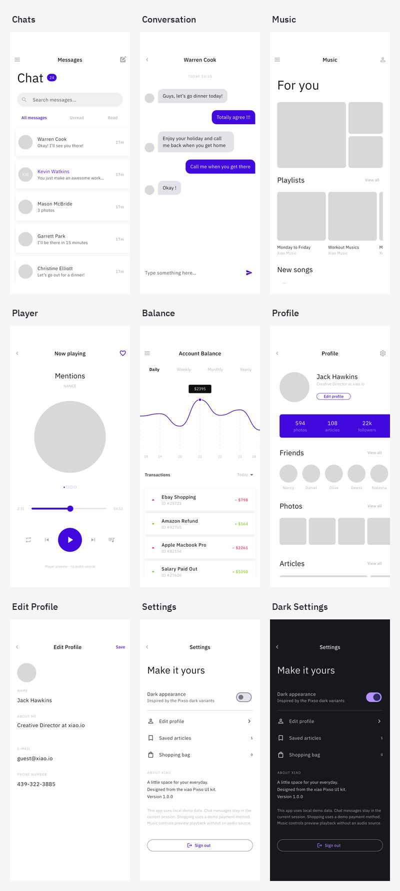
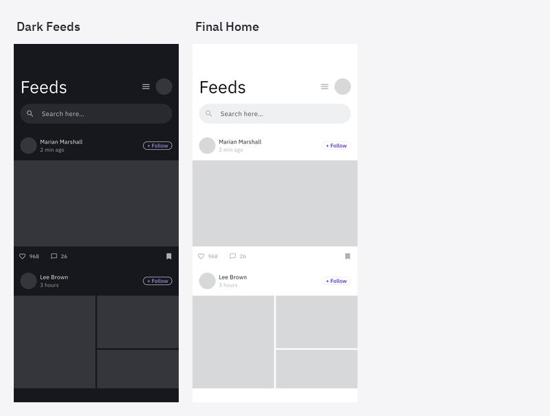

# 界面截图

来自 iPhone 17 Pro / iOS 26.0 模拟器的 Flutter 实际运行画面。原始尺寸 1206 × 2622，PNG 格式。截图由集成测试自动采集，并包含操作后的应用状态。

| 序号 | 页面 | 原始截图 |
| --- | --- | --- |
| 01 | 引导页 | [查看](screenshots/01_walkthrough.png) |
| 02 | 欢迎页 | [查看](screenshots/02_welcome.png) |
| 03 | 注册页 | [查看](screenshots/03_signup.png) |
| 04 | 登录页 | [查看](screenshots/04_login.png) |
| 05 | 动态首页 | [查看](screenshots/05_feeds.png) |
| 06 | 模块导航 | [查看](screenshots/06_navigation.png) |
| 07 | 文章分类 | [查看](screenshots/07_categories.png) |
| 08 | 文章列表 | [查看](screenshots/08_articles.png) |
| 09 | 文章详情 | [查看](screenshots/09_article_detail.png) |
| 10 | 收藏文章 | [查看](screenshots/10_saved_articles.png) |
| 11 | 商城首页 | [查看](screenshots/11_shop.png) |
| 12 | 商品集合 | [查看](screenshots/12_catalogue.png) |
| 13 | 商品详情 | [查看](screenshots/13_product.png) |
| 14 | 购物车 | [查看](screenshots/14_cart.png) |
| 15 | 结算：配送 | [查看](screenshots/15_shipping.png) |
| 16 | 结算：演示支付 | [查看](screenshots/16_payment.png) |
| 17 | 结算：订单核对 | [查看](screenshots/17_order_review.png) |
| 18 | 订单完成 | [查看](screenshots/18_order_success.png) |
| 19 | 会话列表 | [查看](screenshots/19_chats.png) |
| 20 | 聊天详情 | [查看](screenshots/20_conversation.png) |
| 21 | 音乐推荐 | [查看](screenshots/21_music.png) |
| 22 | 音乐播放器 | [查看](screenshots/22_player.png) |
| 23 | 账户面板 | [查看](screenshots/23_balance.png) |
| 24 | 个人资料 | [查看](screenshots/24_profile.png) |
| 25 | 编辑资料 | [查看](screenshots/25_edit_profile.png) |
| 26 | 设置 | [查看](screenshots/26_settings.png) |
| 27 | 深色设置 | [查看](screenshots/27_dark_settings.png) |
| 28 | 深色动态 | [查看](screenshots/28_dark_feeds.png) |
| 29 | 操作后首页 | [查看](screenshots/29_final_home.png) |

24 个路由对应 26 个主要页面状态（三步结算共用一个路由），加上深色示例与流程完成后的首页，共 29 张原始截图。

## 浏览图册

